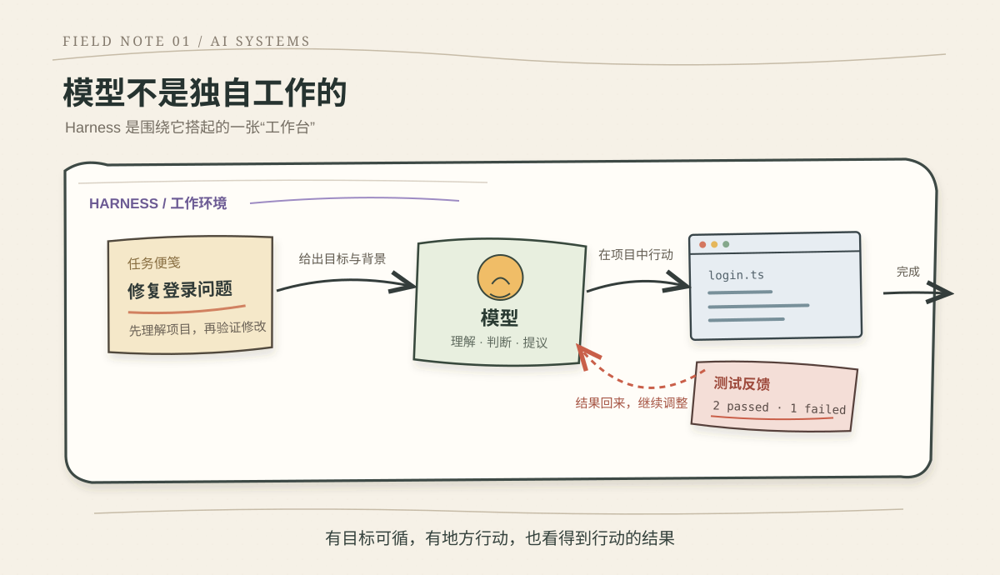
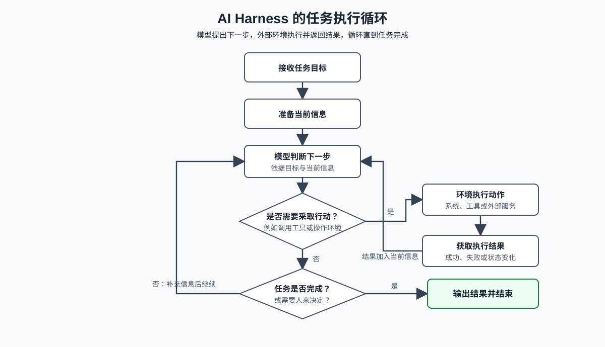
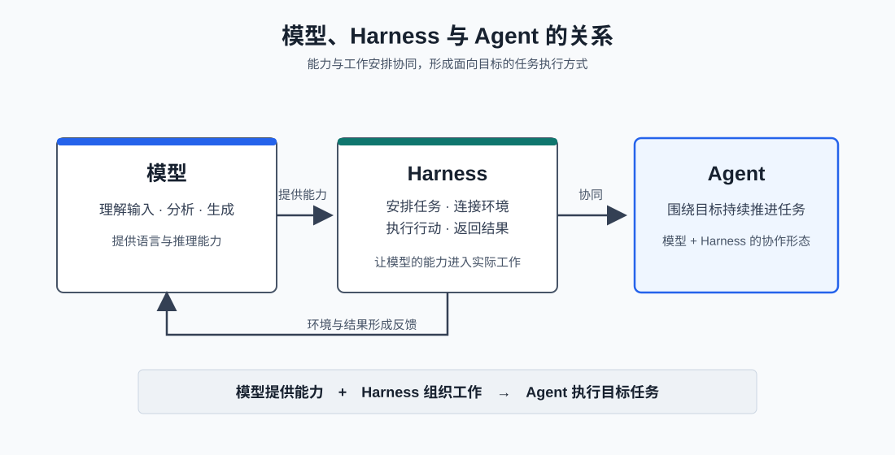

# 什么是 AI Harness

想象你请一位能力很强的新人帮忙：“把这个项目里的登录问题修好。”

他能读懂描述，也能写代码。但如果他看不到项目文件，不知道团队的做事习惯，写完后又不能运行程序验证，那么他给出的可能只是一段看起来合理的建议。要真的让他去解决问题，就得把项目交给他，告诉他从哪里开始，并让他根据自己的修改看到结果反馈并进一步分析直到问题解决。

同样当下的AI模型虽然能理解文字、分析问题、提出答案。但模型本身并不知道当前项目是什么状态，也没有访问文件或执行程序的能力。如果想让大模型拥有帮你做事的能力，你就需要给它一双手，替它准备工作环境，让它能在这个环境里发挥它的价值作用。

这套围绕模型打造的环境，就是我们要理解的 **AI Harness**。


如果你从事的是软件开发相关工作，相信你一定接触过不少编程助手工具，像当下使用比较多的claude code，codex，千问等等。这些编程助手都能在项目中读代码、修改文件、运行测试。它的工作流程如下：

1. 用户告诉 AI 要解决什么问题；
2. AI 查看相关代码，提出修改；
3. 修改被放进实际项目里；
4. 测试运行，暴露成功或失败；
5. AI 根据结果继续调整，直到任务完成或需要人介入。

上述这一系列工作都是AI大模型一个人完成的吗？其实并不是，AI本质上是一个大语言模型，它只能够对你的问题输出文字答案，并没有能力帮你去动手修改你的项目。而AI真正能帮我们修改项目的原因，就是模型之外的这一层harness架构。它把项目代码作为上下文投喂给模型、根据模型的回答判断需要修改哪里，然后再把修改的结果作为反馈告知模型，由模型判断下一步怎么做，这就构成了一个我们常用的agent harness。


*图：Harness 不只是包住模型的一个方框，而是模型工作的整张“工作台”。*

## Harness 到底是什么？

 **harness** 原本指套在马身上的“马鞍”——用来连接马匹与缰绳、车辆或负载，让人能够引导马匹做事。用这个词来形容这一层框架就很生动形象，**AI Harness 就是围绕模型搭起的“马鞍”**：它把模型和具体任务、可用的工作环境连接起来，让模型知道目标是什么、可以采取什么行动，并把行动后的结果带回来。

**模型提供大脑决策，Harness 让大脑决策能够落地实现。**

比如模型提出“运行测试”，Harness 要让测试在合适的项目里运行；测试失败后，Harness 再把报错带回来。模型根据报错调整代码，之后继续验证。这种可持续的运行过程让AI可以落地到更多的行业中去发挥更强大的能力。

## 如何构建一个Harness 

要构建一个有效的Harness ，需要同时具备行动和反馈能力。

可以把 Harness 理解成两个动作：

**行动前，给AI确认方向。**  
例如说明任务目标、提供相关背景、告诉它项目里约定的做法。这样模型可以根据约束规范来决定下一步怎么做，更容易从正确的地方开始。

**行动后，让AI看到结果。**  
例如运行测试、检查文件变化，或者把执行时出现的错误交还给模型。模型看到结果，才能判断刚才那一步是否有效，以及是否需要调整。

Harness 做的是AI的想法创意进行实操，然后让模型根据结果反馈继续改进最终达到想要的效果。


*图：目标进入模型，模型采取一步，环境返回真实结果，结果再成为下一轮判断的依据。*

这也是为什么同一个模型放在不同的应用里，达到的效果可能差很多：一个环境只给它一句模糊要求，另一个环境能给出清楚的背景和及时的结果反馈，两者达到的效果差距天差地别。

## 模型、Harness 和 Agent 是什么关系？

可以用三个简单的说法来区分：

- **模型**：负责理解输入、分析并生成内容。
- **Harness**：负责安排模型如何参与一件具体工作。
- **Agent（智能体）**：模型在 Harness 的安排下，围绕一个目标持续推进任务时，形成的应用形态。

```text
Agent = Model + Harness
```

同一个模型可以被放进不同的 Harness，承担不同任务；一个 Harness 也可以换用不同模型。而模型和 Harness两者的搭配构成了一个Agent（智能体）。


*图：模型提供思考能力，Harness 组织工作，两者共同构成了一个可运行的 Agent。*

## harness的重要性

当gpt刚面世的时候，它仅仅是一个文本模型，当时agent的概念也刚刚兴起，大家重点都放在“模型有多聪明”。但随着现在大模型百花齐放，其使用的成本已经降到可以落地到各个行业处理真实任务的时候，另一个问题变得同样重要：

> 我们怎样能让模型更高效，稳定的完成我们的工作？

这就是 Harness 值得学习的原因。它让我们从“换一个更强的模型试试”，转向搭建一个模型可持续运行的稳定环境：模型拿到了什么信息？它能做什么？行动之后看到了什么？哪些问题能提前发现？

下一章节我会从0手搓一个真正的个人任务智能体 来介绍一个最简单harness框架下实现的智能体雏形是什么样的。

