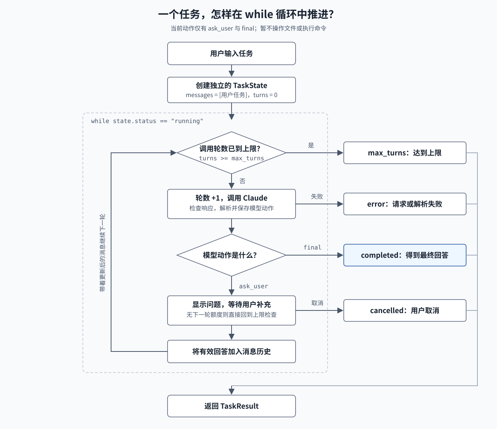
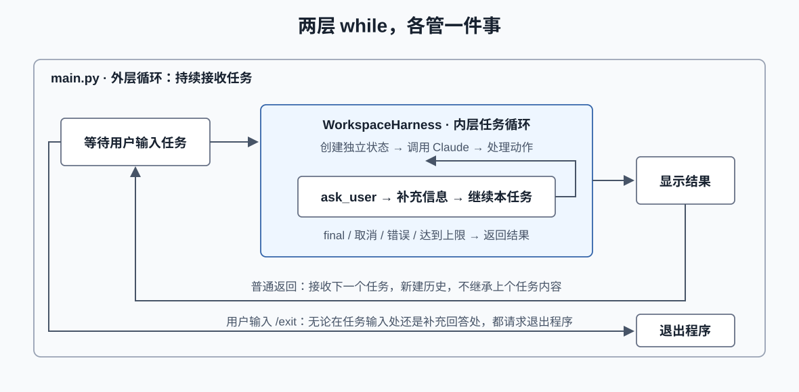
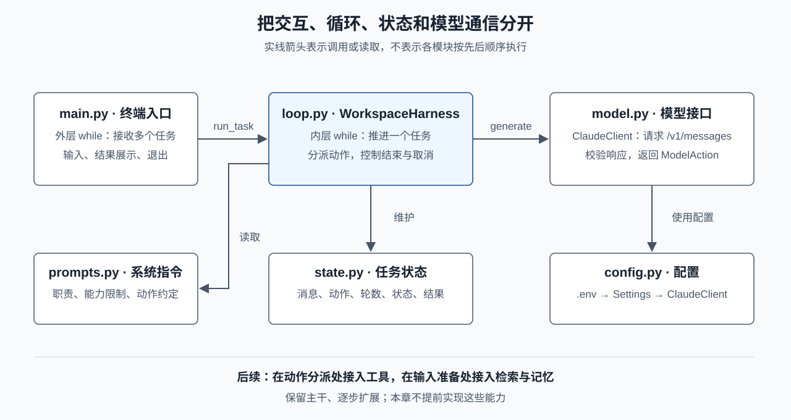
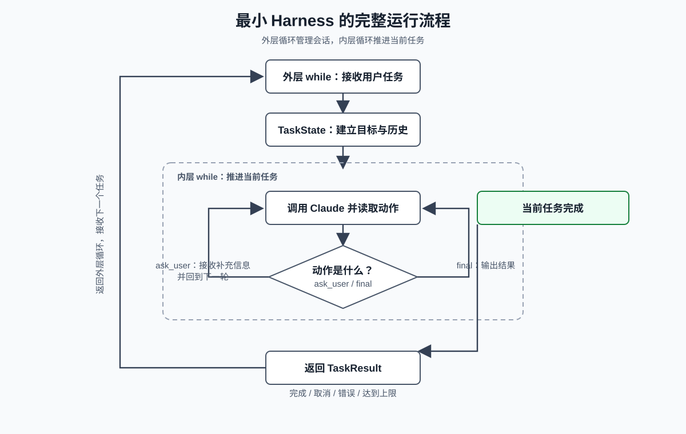

# 手写一个 Agent Loop：个人任务助手

上一章主要说明了什么是 Harness以及harness是 如何与模型合作构造一个真正的智能体。这一章开始将从0开始手搓一个真正的**个人任务助手**智能体。

**个人任务助手**的运行流程：当用户输入一项任务，工作空间任务助手根据用户的需求去进行分析；如果缺少关键信息，就向用户提问；信息足够时，返回一份最终结果。当前版本只分析对话中提供的内容，不读取或修改本地文件，也不执行命令。后续的章节会在这个基础框架的基础上扩展各个功能。

## 这一章要搭什么

本章完成四件事：

1. 用户在终端输入任务。
2. 外层 while 持续接收多个任务，输入 /exit 退出程序。
3. 内层 while 推进一个任务，可以进行 多轮询问和回答。
4. 通过明确的动作协议、任务状态和最大轮数，让循环可以被观察、停止和扩展。

目前个人任务助手底层接入的是Claude 模型 API，后续考虑扩展支持其它厂商模型。

## 先看整体循环

一次任务的最小过程是：


*图：一个任务在内层 while 中推进，所有退出原因最终都会返回 TaskResult。*

外层会话和内层任务的边界如下：


*图：外层负责接收多个任务，内层只负责推进一个任务；每个新任务都会创建独立历史。*

这里有两个不同层次的循环：

- **外层循环**：程序不断接收新的用户任务。
- **内层循环**：当前任务可能经过多次模型调用，直到得到最终回答、用户取消、出现错误或达到轮数上限。

把两层循环分开很重要。一个程序可以连续处理许多任务，但每个任务的消息历史必须独立，不能把上一个任务的内容带到下一个任务里。

在这个章节个人任务助手仅实现了支持分析用户输入的内容，然后根据用户的输入内容进行分析作答，构建一个完整的harness框架。后续章节会在此框架基础上扩充任务助手的功能，**但是用户输入、任务状态、模型接口和 while 循环这几个基础保持不变**。

## 项目结构

```text
agent loop/
├── .env.example                 # 配置模板，不含密钥
├── .env                         # 你的本地配置，不应提交
├── main.py                      # 外层循环和终端入口
├── 02_minimal_agent_loop.py     # 兼容旧运行命令的入口
├── harness/
│   ├── config.py                # .env、接口地址和运行参数
│   ├── model.py                 # LangChain Claude 适配器与动作解析
│   ├── state.py                 # 消息、动作和任务状态
│   ├── prompt_loader.py         # 加载外部提示词资源
│   └── loop.py                  # 单个任务的 while 循环
└── tests/
    └── test_harness.py          # 不调用网络的离线测试
```

每一层只负责一件事：终端负责与用户交互，Loop 负责推进任务，Model 负责通信，State 负责任务记录。


*图：入口、循环、状态和模型通信彼此分开，后续能力可以接在循环的动作分支上。*

## 配置 Claude 模型

先将 .env.example 复制为 .env，然后填写配置：

```dotenv
ANTHROPIC_API_KEY=你的密钥
ANTHROPIC_MODEL=你要使用的Claude模型ID
ANTHROPIC_BASE_URL=https://api.anthropic.com
# 使用代理时，也可以直接填写完整的 HTTPS /v1/messages 地址
# ANTHROPIC_API_URL=
```

代码通过 LangChain 1.2 的 `ChatAnthropic` 调用 Claude Messages API。`ANTHROPIC_BASE_URL` 应填写 HTTPS 基础地址，例如 `https://api.anthropic.com`；LangChain 会负责补充 API 路径。如果服务商提供兼容 Anthropic 协议的代理，也可以填写它的基础地址。代码会拒绝 HTTP 地址、带用户名密码的 URL 和带查询参数的 URL，避免把密钥放进不安全的地址。

其他可选参数：

```dotenv
ANTHROPIC_VERSION=2023-06-01
ANTHROPIC_MAX_TOKENS=2048
ANTHROPIC_TIMEOUT_SECONDS=120
HARNESS_MAX_TURNS=8
```

.env 已加入 .gitignore。不要把真实密钥提交到仓库，也不要把密钥放进文章、截图或模型消息中。

## 运行程序

在本章目录中运行：

```bash
python main.py
```

也可以使用兼容入口：

```bash
python 02_minimal_agent_loop.py
```

启动后可以输入例如：

```text
你：帮我制定一个 Python 项目的上线检查清单
```

如果 Claude 认为缺少信息，它会返回一个问题，终端会等待你的补充；如果信息足够，它会返回最终结果。输入 /cancel 取消当前任务，输入 /exit 退出程序。

## 模型和 Harness 之间如何通信

在这个章节对于模型返回的内容进行了规范：在提示词里限制模型返回一个json对象体结构的信息，当前规范了下面两种结构体内容：

```json
{"action":"ask_user","message":"项目部署在哪种环境？"}
```

或：

```json
{"action":"final","message":"下面是一份上线检查清单……"}
```

ask_user 表示模型需要用户补充信息；final 表示本次任务可以输出结果。当前版本主要是构造了一个完整的harness运行流程，在这个流程中演示了在智能体循环（agent loop）的过程中模型是怎么与外部环境进行交互从而完成整个任务流程的。

harness/model.py 中的 ClaudeClient 使用 LangChain 的 `ChatAnthropic` 完成模型通信，再把 `AIMessage` 转换为 `ModelAction`。它不读取终端、不保存任务历史，也不决定循环是否结束。提示词正文放在 `prompts/workspace-assistant.md`，由 `harness/prompt_loader.py` 读取；这样修改角色、能力边界或输出协议时，不需要改动 Python 逻辑。

轻量解析函数的核心形态如下：

```python
def parse_action(text: str) -> ModelAction:
    payload = json.loads(text)
    action = payload.get("action")
    message = payload.get("message")

    if action not in ("ask_user", "final"):
        raise ModelError("当前版本只支持 ask_user 和 final 动作")
    if not isinstance(message, str) or not message.strip():
        raise ModelError("message 必须是非空字符串")

    return ModelAction(kind=action, message=message.strip())
```

这不是完整的结构化输出保证。模型仍可能返回格式错误，因此代码遇到无法解析的响应时会停止本次任务，不会猜测文本含义，更不会自动执行文本里的指令。

## TaskState：记录一次任务

一次任务至少要记录：

- 用户的原始目标；
- 当前任务的消息列表；
- 已经调用模型的轮数；
- 当前状态和停止原因；
- 最终回答。

harness/state.py 用 TaskState 表示这些信息：

```python
@dataclass
class TaskState:
    goal: str
    messages: list[Message] = field(default_factory=list)
    turns: int = 0
    status: TaskStatus = "running"
    answer: str = ""
    stop_reason: str = ""
```

当用户回答模型的问题时，回答会作为新的 user 消息加入当前任务；模型的动作也会作为 assistant 消息保存。这样下一次请求能看到完整的本次对话。

这里的消息历史只服务于当前任务，不能把它误认为长期记忆。下一章会继续明确上下文边界，后续“上下文与记忆”章节再把它扩展到任务之外。

## WorkspaceHarness.run_task：内层 while 循环

这是本章最重要的函数。它不关心用户要做的是上线清单、文档润色还是研究提纲，只负责推进任务：

```python
while state.status == "running":
    if state.turns >= self.max_turns:
        state.status = "max_turns"
        break

    state.turns += 1
    action = self.model.generate(tuple(state.messages), self.system_prompt)
    state.messages.append(Message("assistant", action.to_json()))

    if action.kind == "final":
        state.status = "completed"
        state.answer = action.message
        break

    if action.kind == "ask_user":
        answer = input_fn("你（/cancel 取消任务）：").strip()
        state.messages.append(Message("user", answer))
```

真实代码还处理了空输入、用户取消、Ctrl+C、模型错误和接口响应截断。这段简化代码用于看清顺序：

1. 检查是否还能继续；
2. 调用一次模型；
3. 保存模型动作；
4. final 结束任务；
5. ask_user 等待用户回答，再进入下一轮。

while 比猜数字示例里的 for 更适合真实任务，因为循环结束不是由固定次数决定，而是由模型动作、用户操作或运行边界共同决定。但 while 必须配合 max_turns，否则模型持续提问或接口异常时，程序可能永远运行。

## main.py：外层用户交互循环

外层循环只管理多个任务：

```python
while True:
    goal = input("\n你：").strip()

    if goal.lower() in ("/exit", "/quit"):
        break
    if not goal:
        continue

    result = harness.run_task(goal)
    print(result.answer)
```

main.py 不负责解析 Claude 返回的 JSON，也不负责拼接 API 请求。将来把终端换成 Web 页面或 HTTP 服务时，可以替换这个入口，复用同一个 WorkspaceHarness。

## 哪些情况会结束任务

当前代码明确区分几种状态：

| 状态 | 含义 |
|---|---|
| completed | Claude 返回 final，得到本次回答 |
| cancelled | 用户输入 /cancel、/exit 或中断输入 |
| max_turns | 达到模型调用轮数上限 |
| error | 配置、网络、响应或动作解析失败 |

只有 completed 表示模型完成了本次回答。其他状态都不会伪装成成功，也不会自动重试或继续执行未知动作。

## 当前 Harness 的边界

这个版本已经是真实模型驱动而构造的一个最小harness结构：

- 它能理解用户输入并进行多轮澄清；
- 它能保存当前任务的消息历史；
- 它能控制轮数、取消和错误；

## 离线测试

本章提供了不调用网络的测试：

```bash
python -m unittest discover -s tests -v
```

测试使用模拟模型和模拟的 LangChain `invoke` 响应，不发送真实请求；覆盖最终回答、补充信息、空输入、取消、轮数上限、配置校验、响应错误和敏感信息不进入错误日志等情况。你可以在填写真实密钥前先运行它。

## 本章小结

这次手写的最小 Harness 演示了其工作运行的一个完整流程，可以更清晰明白它的工作原理：


*图：外层循环管理多个用户任务，内层循环推进单个任务；任务结束后返回状态，再由外层循环接收下一个任务。*

模型提供判断，Harness 负责把判断放进一个可控的运行过程。下一章节将引入工具的概念，使得harness真正拥有执行能力的双手！

