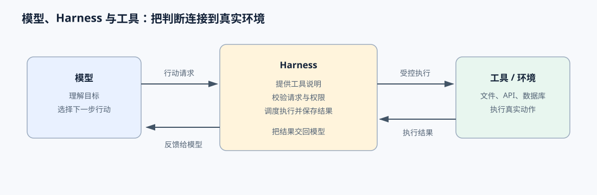
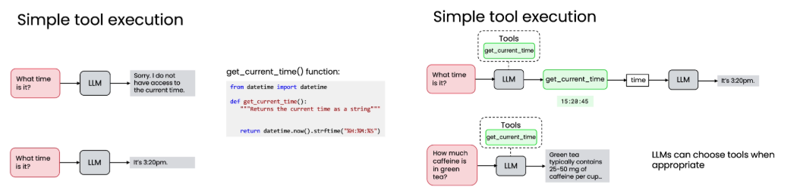
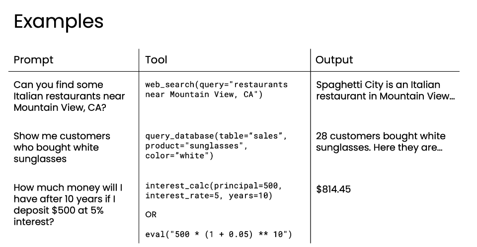
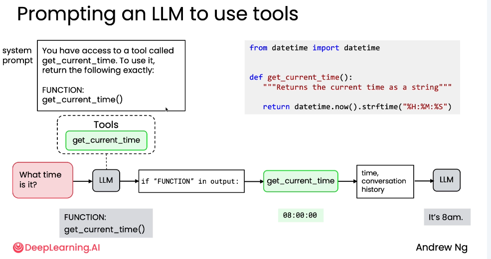
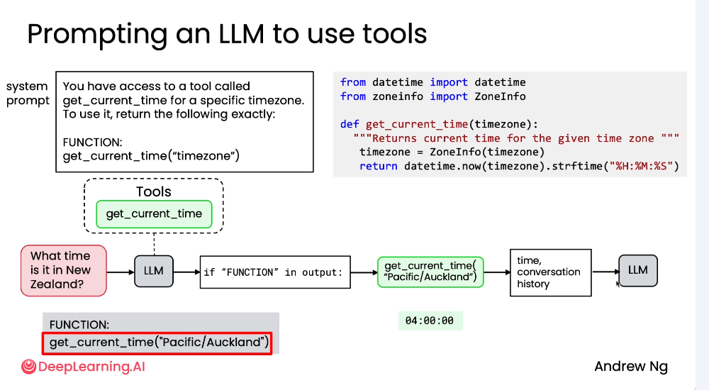
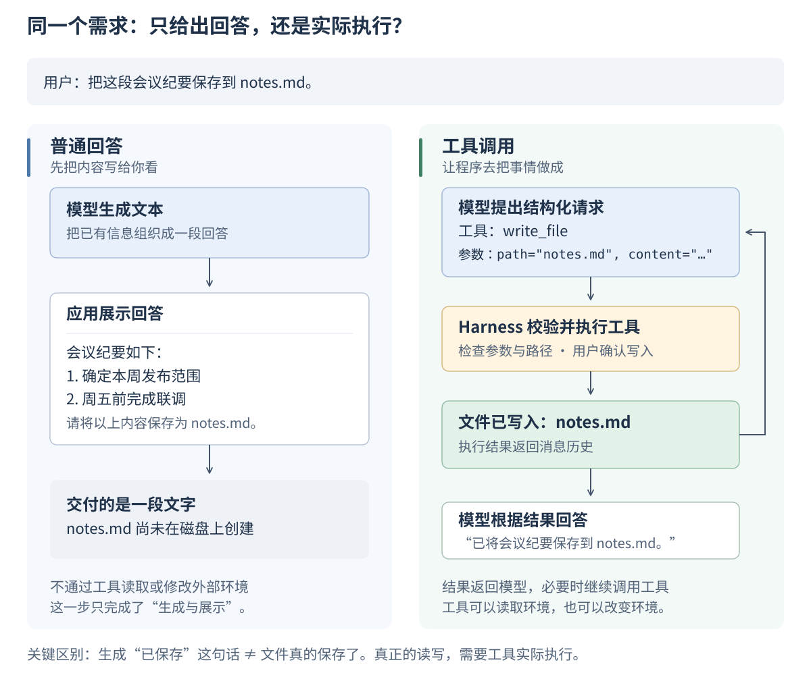
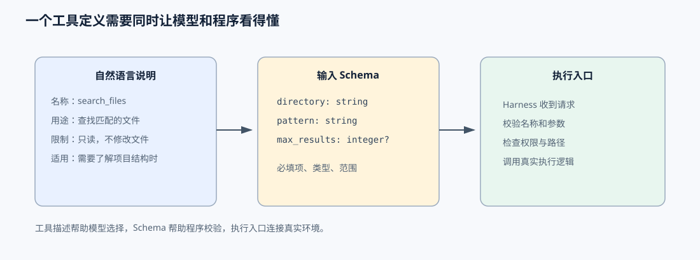
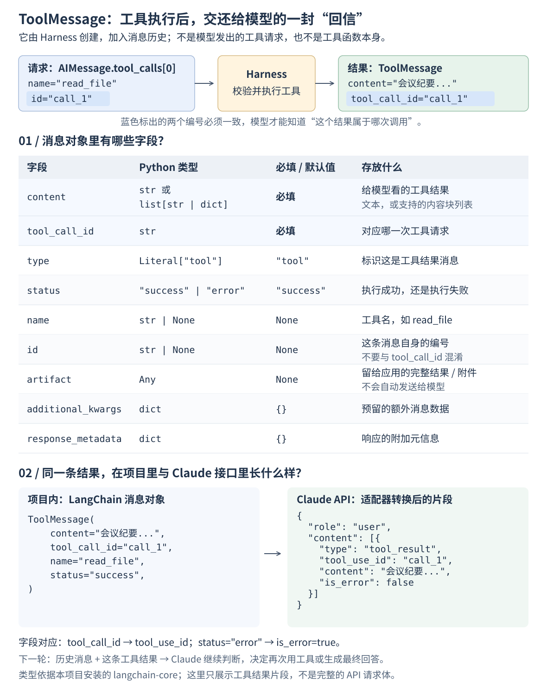
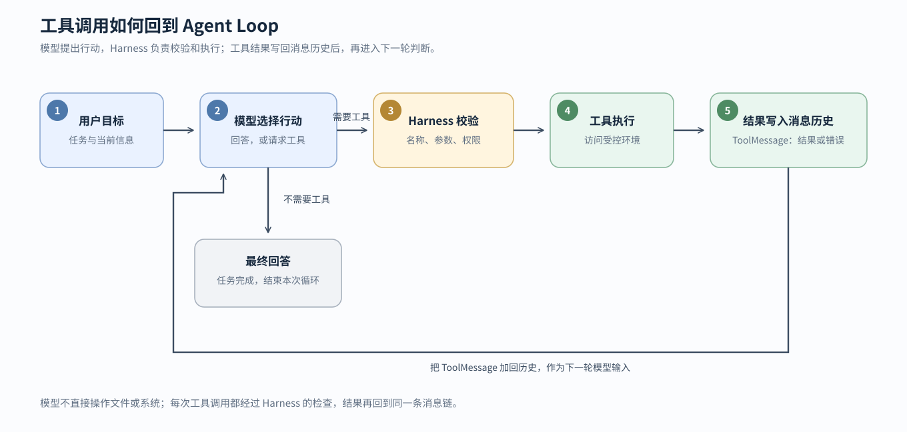

# 第三章：给Agent添上连接外部世界的双手- 工具

在前面的章节中，我实现了一个小型Agent，这个Agent已经能够理解用户目标、提出问题，并在多轮对话中给出最终回答。但这个 Agent 仍然只能“说”，不能真正查看文件、查询天气、计算数据、调用接口或修改项目。

如果把模型比作人的大脑，那么工具就是这个人的双手。模型负责判断“下一步需要做什么”，工具负责在真实环境里根据模型的意图去执行这个决策，然后再把执行结果返回给模型进行下一步的决策判断。



*图：模型负责判断，Harness 负责调度，工具负责在真实环境中完成动作。*

## 引言 Introduction

**工具使用是什么？**

工具使用（Tool Use）是构建下一代 AI 应用的核心技术。它让大型语言模型（LLM）从"只会聊天"的伙伴，进化为能够"动手做事"的智能助手。

拥有工具后模型不再是被动地根据内部训练的数据信息生成答案，而是能主动判断：在当前情境下，是否需要、以及应该调用哪个工具来完成任务。就像人类借助锤子、扳手等工具能完成徒手无法做到的事情一样，语言模型通过调用"函数工具"，也能突破自身训练数据和能力的限制，变得无比强大。

---

## 一、工具使用的基本原理 Basic Principles

### 1.1 简单工具执行流程 (Simple Tool Execution)

以"现在几点？"为例，清晰展示了工具使用的完整闭环：

1. **输入提示 (Input Prompt)**: 用户提问 "What time is it?"。
2. **模型决策 (Model Decision)**: LLM 意识到自己无法提供实时时间，于是决定调用名为 `get_current_time()` 的工具。
3. **工具执行 (Tool Execution)**: 系统执行该函数，返回精确的时间值，例如 `15:20:45`。
4. **结果反馈 (Result Feedback)**: 这个时间值被作为新的上下文（对话历史）回传给 LLM。
5. **最终输出 (Final Output)**: LLM 结合这个新信息，生成自然语言回复："It's 3:20pm."

**整个过程的关键点：**
- **工具是函数**：`get_current_time()` 是一段 Python 代码，它负责与系统时钟交互并返回字符串。
- **模型自主选择**：模型自行决定何时、何地调用哪个工具。
- **动态上下文**：工具返回的结果会融入对话历史，供模型后续推理使用。



### 1.2 条件性调用 (Conditional Invocation)

工具使用的一个重要特性是条件性调用。模型并非对所有问题都盲目调用工具，而是能智能判断。

- **调用工具的例子**：当被问及"现在几点？"，模型知道需要实时数据，因此调用 `get_current_time()`。
- **不调用工具的例子**：当被问及"绿茶含多少咖啡因？"，模型可以基于其内部训练的知识数据直接回答："Green tea typically contains 25-50 mg of caffeine per cup."，无需调用任何工具。

这体现了模型的"智能"——它能区分哪些信息是静态的（可内化），哪些是动态的（需外求）。

### 1.3 实际应用示例 (Practical Examples)

| Prompt (提示) | Tool (工具) | Output (输出) |
| :--- | :--- | :--- |
| "你能找到加州山景城附近的一些意大利餐厅吗？" | `web_search(query="restaurants near Mountain View, CA")` | "Spaghetti City 是一家位于山景城的意大利餐厅..." |
| "给我看看买了白色太阳镜的顾客。" | `query_database(table="sales", product="sunglasses", color="white")` | "28位顾客购买了白色太阳镜。他们是..." |
| "如果我存入500美元，年利率5%，10年后我会得到多少钱？" | `interest_calc(principal=500, interest_rate=5, years=10)` | "$814.45" |



---

## 二、创建工具的方法 Creating Tools

### 2.1 工具调用的本质 (The Nature of Tool Calling)

**重要概念**：LLM 本身并不会直接执行代码或调用函数，它被训练的核心能力是生成文本。

**核心思想**：模型不直接调用，而是"请求"调用。工具其实就是一些代码/函数。如今的主流语言模型都经过直接训练去使用工具，没有训练就必须得写提示词来告诉模型如何使用工具。

**实现工具使用的流程：**
1. **开发者编写工具函数**：例如 `get_current_time()`。
2. **开发者编写系统提示词 (System Prompt)**：告诉模型，如果它想使用某个工具，应该如何格式化它的输出。
3. **模型根据提示词输出特定格式的文本**：这个文本不是最终答案，而是一个"请求"，例如 `FUNCTION: get_current_time()`。
4. **开发者编写解析代码**：读取模型的输出，识别出这个"请求"，然后真正地调用对应的函数。
5. **将函数结果回传给模型**：把函数返回的结果作为新的上下文输入给模型，让它生成最终的自然语言回复。

就像你不能直接命令一个只会说话的人去帮你买咖啡，但你可以告诉他："如果你想去买咖啡，请说'我要买一杯美式'。" 然后你听到这句话后，自己去帮他买。

### 2.2 早期方法：手动提示工程 (Manual Prompt Engineering)

在 LLM 尚未被直接训练来使用工具时，开发者必须通过编写详细的系统提示词来"告诉" LLM 如何请求调用工具。

**以 `get_current_time` 工具为例，展示完整的交互流程：**

#### 步骤一：提供工具和系统提示

1. **实现工具**：开发者编写好 `get_current_time()` 函数。
2. **设计系统提示 (System Prompt)**：编写一个提示词，明确告知 LLM 它可以访问这个工具，并规定调用它的精确格式。
   ```
   You have access to a tool called get_current_time. To use it, return the following exactly:
   FUNCTION: get_current_time()
   ```

#### 步骤二：用户提问与模型响应

1. **用户提问**："What time is it?"
2. **LLM 决策**：LLM 分析问题后，意识到需要获取当前时间。
3. **LLM 输出**：根据系统提示的要求，LLM 不会直接回答，而是输出预设的触发文本：
   ```
   FUNCTION: get_current_time()
   ```

#### 步骤三：开发者代码介入

1. **解析输出**：开发者编写的程序读取 LLM 的输出。
2. **识别意图**：检查输出中是否包含 "FUNCTION" 关键字。
3. **提取参数**：如果包含，则提取出要调用的函数名 `get_current_time` 及其参数（此例中无参数）。
4. **执行工具**：程序实际调用 `get_current_time()` 函数，获得返回值（如 `"08:00:00"`）。

#### 步骤四：反馈结果并生成最终答案

1. **构建对话历史**：将工具的执行结果（如 `"08:00:00"`）连同之前的对话历史（用户问题、LLM 的函数请求）一起，作为新的上下文输入给 LLM。
2. **LLM 生成最终回复**：LLM 接收到包含工具执行结果的新上下文后，知道之前发生了什么（用户问时间 -> LLM 请求调用函数 -> 函数返回了"8点"），于是生成自然语言的最终回复："It's 8am."



### 2.3 处理带参数的工具 (Handling Tools with Parameters)

当工具函数需要参数时，流程类似，但提示词和 LLM 的输出需要包含参数信息。

**示例：获取指定时区的时间**

1. **实现工具**：编写一个带参数的函数 `get_current_time(timezone)`。
2. **修改系统提示**：
   ```
   You have access to a tool called get_current_time for a specific timezone. To use it, return the following exactly:
   FUNCTION: get_current_time("timezone")
   ```
3. **用户提问**："What time is it in New Zealand?"
4. **LLM 输出**：LLM 会根据提示格式，输出带有具体参数的文本：
   ```
   FUNCTION: get_current_time("Pacific/Auckland")
   ```
5. **开发者代码**：解析出函数名和参数 `"Pacific/Auckland"`，然后调用 `get_current_time("Pacific/Auckland")`。
6. **反馈与回复**：将执行结果（如 `"04:00:00"`）反馈给 LLM，最终 LLM 回复："It's 4am in New Zealand."



### 2.4 现代方法：原生工具支持 (Modern Approach: Native Tool Support)

当前主流的 LLM 都经过了直接训练，能够原生地理解何时以及如何请求调用工具。

**优势：**
- 开发者不再需要像过去那样在提示词中硬编码特定的触发语法（如全大写的 "FUNCTION"）。
- 只需向 LLM 提供工具的描述和可用性，模型会自行决定何时调用。
- 更自然、更可靠的工具调用体验。

---

## 三、工具调用和普通文本回答有什么不同

普通回答的结果是文本：模型生成一段内容，应用程序把它展示给用户。

工具调用的结果是一种“动作请求”：模型需要把工具名称和参数交给 Harness，Harness 执行后再返回结果。模型在拿到结果之前，通常不能知道工具到底做成了什么。



*图：同样是“保存会议纪要”，普通回答只交付文字；而有了工具这个功能则会真正可以创建用户要求的文件并写入内容。执行结果回到模型后，模型可以继续调用工具，也可以根据结果回答用户。*


## 四、工具的输入为什么要有结构

结构化输入会把工具请求变得明确。例如，一个搜索工具可以规定：

```text
工具名：search_files
用途：在指定目录中查找匹配的文件
输入：
  - directory：搜索目录，字符串，必填
  - pattern：文件匹配模式，字符串，必填
  - max_results：最多返回多少条，整数，可选
```

在实际系统中，这些输入规则通常会使用 JSON Schema 或框架提供的结构化定义来表达。



*图：工具说明把自然语言用途、输入结构和执行入口连接在一起。*

目前像LangChain 这样的框架已经把工具调用的结构都封装好了，一般都不需要我们去手写维护，还是很方便的。

## 五、把工具接入工作空间任务助手

前面的内容解释了工具调用的原理，下面结合本章实现的工具调用代码，讲解一下工具调用在项目中的工程实践。

本章的改造不再硬编码提示词 让 模型 返回固定的 `{"action":"final"}` 或 `{"action":"ask_user"}` JSON这样的结构体，而是直接使用 LangChain 的 `AIMessage`消息体来接收模型返回的消息 ：AIMessage是LangChain 里封装的统一用来接收模型调用返回结构的数据类，当模型认为需要调用工具时就会在 `AIMessage.tool_calls` 返回需要调用的工具数组，不需要工具调用时则可以把 `AIMessage.content` 当作最终回答。

### 5.1 任务状态直接保存 LangChain 消息

第二章的历史记录只需要保存用户消息和自定义的助手动作。加入工具后，消息历史里同时还要保存工具调用链，因此 `TaskState` 使用 LangChain 的 `BaseMessage`：

```python
from langchain_core.messages import BaseMessage, HumanMessage

@dataclass
class TaskState:
    goal: str
    messages: list[BaseMessage] = field(default_factory=list)
    turns: int = 0
    tool_calls: int = 0

    @classmethod
    def start(cls, goal: str) -> "TaskState":
        return cls(goal=goal, messages=[HumanMessage(content=goal)])
```

一次带工具的任务，消息历史可能是：

```text
HumanMessage：用户任务
AIMessage：请求 search_files
ToolMessage：返回文件列表
AIMessage：根据结果生成回答
```

这里必须保留工具调用 ID。`AIMessage.tool_calls` 中的 `id` 会传给对应 `ToolMessage.tool_call_id`，模型 才能知道某个结果对应哪一次调用。

#### 看懂 `ToolMessage`：工具结果是怎样回到模型的



ToolMessage最常用的的参数是 `content`（执行结果）、`tool_call_id`（对应的调用编号）、`name`（工具名）和 `status`（成功或失败）；`type` 默认就是 `"tool"`，通常不需要手动填写。注意，`id` 是**消息自身的编号**，不是用来配对工具请求的 `tool_call_id`。`artifact` 可以留存完整结果或附件供应用使用，但不会自动发送给模型。

图中右下角的 `role: "user"` 是 **表示这是工具调用结果的返回**，并不代表用户又输入了一段话。我，`ChatAnthropic` 方法内部会自动将ToolMessage里传入的参数 转换为 `tool_result` json内容块。

### 5.2 bind_tools 绑定工具

在模型初始化成功后，只需要将已经注册好的工具通过bind_tools方法绑定到模型中，模型就会了解到当前有这些工具可以使用。

```python
model = ChatAnthropic(
    model_name=settings.model,
    max_tokens_to_sample=settings.max_tokens,
    timeout=settings.timeout_seconds,
    max_retries=0,
    api_key=settings.api_key,
    base_url=base_url,
)

self._model = model.bind_tools(list(tools))
```

调用模型时，Harness 把系统提示词和历史消息交给 Claude：

```python
response = self._model.invoke([
    SystemMessage(content=system_prompt),
    *messages,
])
```

模型回复的response返回体就是一个 `AIMessage`。

它可能有两种形态：

```python
# 直接回答结果，无需调用工具
AIMessage(content="项目中有 3 个 Python 文件。", tool_calls=[])

# 模型返回结果告诉我们这个任务需要请求search_files工具来解决问题
AIMessage(
    content="",
    tool_calls=[
        {
            "name": "search_files",
            "args": {"pattern": "*.py"},
            "id": "call-1",
        }
    ],
)
```

### 5.3 使用 `StructuredTool` 定义文件工具

目前先注册了三个文件工具，分别可以用来查找，读取以及写入文件：

- `search_files`：按文件名模式搜索文件；
- `read_file`：读取 文本文件；
- `write_file`：写入  文本文件。

工具函数由 `WorkspaceFileTools` 统一管理，随后通过 `StructuredTool.from_function` 转换为 LangChain 工具：

```python
StructuredTool.from_function(
    self.read_file,
    name="read_file",
    description="读取工作区内的 UTF-8 文本文件。只能读取工作区目录内的路径。",
)
```

工具的函数签名会被 LangChain 转成参数 Schema。例如：

```python
def search_files(self, pattern: str = "*", max_results: int = 50) -> str:
    ...
```

模型因此能看到 `pattern` 和 `max_results` 的类型及默认值，而不是只看到一段模糊的自然语言。

### 5.4 规定文件工具的工作区边界

对于工具同时还需要规范工具的权限，文件工具不能直接接受任意系统路径。因此在调用工具前会先检查修改的目录是不是在当前目录下，不是则不允许修改：

```python
def _safe_path(self, path: str) -> Path:
    candidate = Path(path)
    resolved = (candidate if candidate.is_absolute() else self.root / candidate).resolve()
    try:
        resolved.relative_to(self.root)
    except ValueError as exc:
        raise ValueError("路径必须位于工作区目录内。") from exc
    return resolved
```

因此，类似 `../secret.txt` 的路径会被拒绝。这是工具调用的第一道边界：模型可以提出路径，但不能因此获得整个磁盘的访问权限。

读取工具还限制最大返回长度，搜索工具限制最大返回条数；这样可以避免一份过大的文件或目录列表直接占满上下文。

### 5.5 用注册表集中管理工具

`ToolRegistry` 用于注册要使用的工具：

```python
registry = ToolRegistry([ask_user, *file_tools])

def register(self, tool: Any) -> None:
    name = getattr(tool, "name", "")
    if not name:
        raise ValueError("工具必须有非空 name。")
    if name in self._tools:
        raise ValueError(f"工具已存在：{name}")
    self._tools[name] = tool
```

注册表解决了两个问题：一方面，它把工具集中起来传给 `bind_tools`；另一方面，执行器可以根据模型返回的工具名查找真实工具，而不是动态导入任意函数。

### 5.6 规范工具的安全区域

`ToolPolicy` 定义工具调用边界：

```python
policy = ToolPolicy(
    allowed_tools=registry.names(),
    require_confirmation=frozenset({"write_file"}),
    max_tool_calls=20,
    max_calls_per_turn=3,
    max_output_chars=8_000,
)
```

`ToolExecutor` 执行模型请求时依次检查：

1. 工具名称是否存在；
2. 工具是否在白名单中；
3. 参数是否为对象；
4. 写入工具是否得到用户确认；
5. 工具执行是否抛出异常；
6. 返回结果是否需要截断。

执行成功后，统一生成 `ToolMessage`：

```python
output = tool.invoke(args)
return ToolMessage(
    content=self._limit(str(output)),
    tool_call_id=call_id,
    name=name,
)
```

工具失败也会生成错误状态的 `ToolMessage`，而不是让程序直接崩溃：

```python
ToolMessage(
    content="工具执行失败：FileNotFoundError。",
    tool_call_id=call_id,
    status="error",
)
```

### 5.7 `ask_user` 也作为工具处理

第三章把“向用户补充提问”也纳入同一套消息协议。模型调用 `ask_user` 后，执行器不运行普通函数，而是使用 CLI 的 `input_fn` 读取用户回答：

```python
answer = input_fn(f"助手：{question}\n你：").strip()
return ToolMessage(
    content=answer,
    tool_call_id=call_id,
    name="ask_user",
)
```

因此，模型的三种行为统一为：

```text
AIMessage
   ├── tool_calls = ask_user  → 读取用户回答
   ├── tool_calls = 文件工具  → 执行并返回 ToolMessage
   └── tool_calls 为空        → content 作为最终回答
```

用户输入 `/cancel` 或 `/exit` 时，执行器会把任务标记为取消，并将退出请求传回外层 CLI。

### 5.8 Agent Loop 如何处理 AIMessage

改造后的核心循环如下：

```python
response = self.model.generate(tuple(state.messages), self.system_prompt)
state.messages.append(response)

tool_calls = response.tool_calls or []
if not tool_calls:
    state.answer = message_to_text(response.content)
    state.status = "completed"
    break

for tool_call in tool_calls:
    state.tool_calls += 1
    result = self.executor.execute(
        tool_call,
        input_fn=input_fn,
        confirm_fn=input_fn,
    )
    state.messages.append(result.message)
```

如果模型返回普通文本，任务结束；如果返回工具调用，工具结果被追加到消息历史，`while` 循环再次请求 Claude。这样工具调用只是 Agent Loop 的一个分支，而不是另一套独立的执行系统。

代码同时限制单轮工具调用数和整个任务的工具调用总数，防止模型反复调用工具造成死循环或成本失控。


## 本章小结

本章在上一章节构建的agent基础上引入了工具，让agent拥有了调用工具的功能，这样它就能在权限允许的范围内帮我们实现我们想做的事情，你想让agent帮你实现什么，你就可以在这个工具框架内添加对应的工具，让agent变得越来越强大！



*图：用户目标进入循环后，模型提出行动，Harness 负责校验和调度，工具执行结果再写回消息历史，供模型继续判断。*

